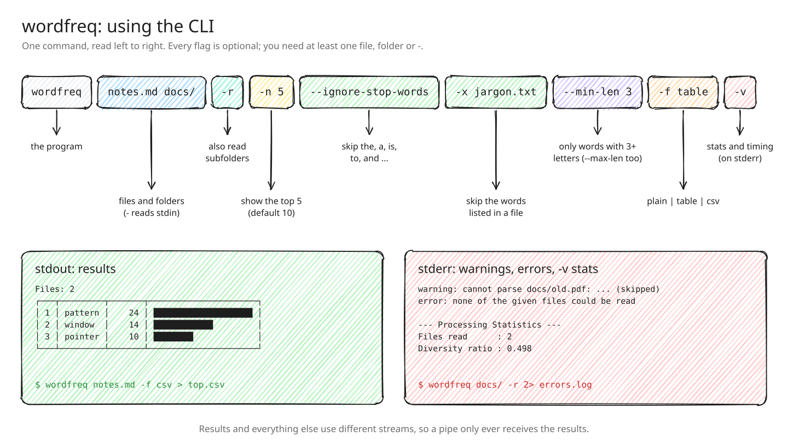
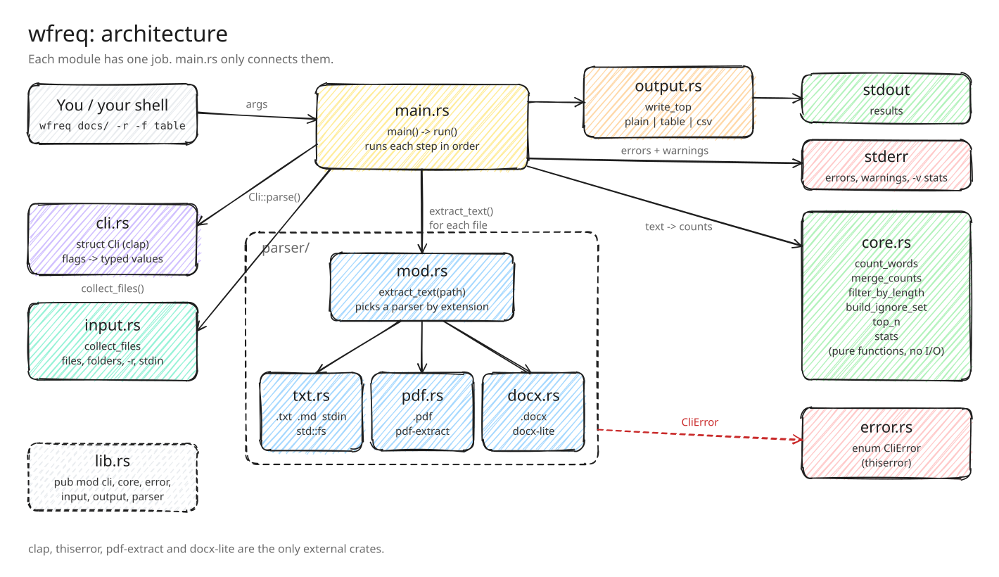
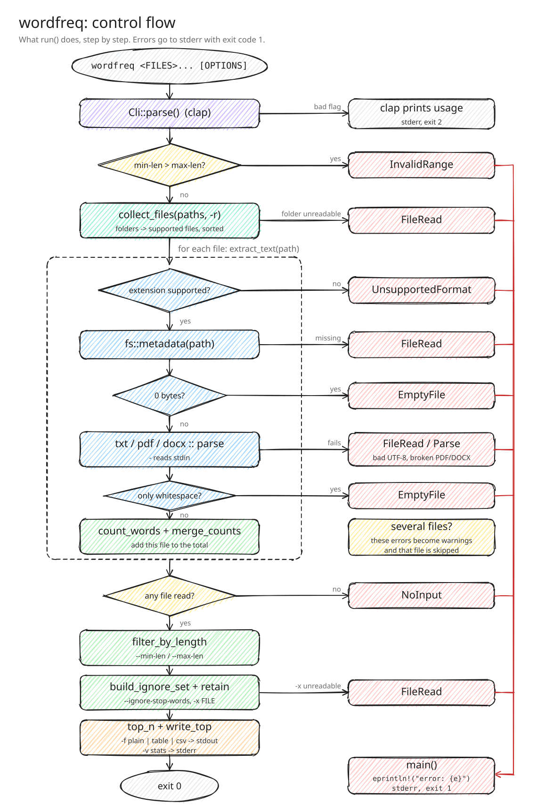

# wfreq

[](https://github.com/yashksaini-coder/wordfreq/actions/workflows/ci.yml)
[](https://crates.io/crates/wfreq)

Show the top N most frequent words in `.txt`, `.md`, `.pdf` and `.docx` files, whole folders, or text piped in on stdin.


## Install

```
cargo install wfreq
```

Or download a binary for Linux, macOS or Windows from the [releases page](https://github.com/yashksaini-coder/wordfreq/releases), or build from source with Rust 1.88 or newer:

```
git clone https://github.com/yashksaini-coder/wordfreq
cd wordfreq
cargo build --release   # binary at target/release/wfreq
```

## Usage

```
wfreq [OPTIONS] <FILES>...
```

`<FILES>` can be any mix of files, folders and `-` for stdin. All of them are counted together.

```
wfreq notes.md                        # top 10 words
wfreq book.pdf -n 20 -f table         # top 20, as a table
wfreq docs/ -r --ignore-stop-words    # a folder and its subfolders, without common words
wfreq a.txt b.docx -f csv > top.csv   # two files, saved as CSV
cat notes.md | wfreq -                # text from stdin
```

| Option                         | What it does                                                                   |
| ------------------------------ | ------------------------------------------------------------------------------ |
| `-n, --top <N>`                | How many words to show. Default is 10.                                         |
| `-f, --format <FORMAT>`        | `plain` (default), `table` or `csv`.                                           |
| `-r, --recursive`              | When a folder is given, also read the files in its subfolders.                 |
| `-i, --case-sensitive`         | Count `The` and `the` as different words. By default all words are lowercased. |
| `--ignore-stop-words`          | Skip common words: the, for, on, in, and, a, is, to.                           |
| `-x, --exclude <FILE>`         | Skip the words listed in a file, one word per line.                            |
| `--min-len <N>`                | Only count words with at least N letters. Default is 1.                        |
| `--max-len <N>`                | Only count words with at most N letters.                                       |
| `-v, --verbose`                | Print files read, total words, unique words, diversity ratio and time.         |
| `-h, --help` / `-V, --version` | Show help / version.                                                           |

<details>
<summary>All the flags in one picture</summary>



</details>

<details>
<summary>How words are counted</summary>

- Text is split on spaces and new lines.
- Everything except letters, numbers and apostrophes is removed, so `hello,` becomes `hello` and `don't` stays `don't`.
- Words are lowercased unless `--case-sensitive` is used.
- `--min-len` and `--max-len` count letters, not bytes, so `café` has 4 letters.
- `--ignore-stop-words` and `--exclude` can be used together.
- Counts from all files are added together. Words with the same count are sorted alphabetically.

</details>

<details>
<summary>Files, folders, output and errors</summary>

**Files and folders**

- A file given by name is always tried. If its type is not supported, that is reported.
- A folder adds the supported files directly inside it. Other files, like `.csv`, are skipped. With `-r`, subfolders are read too.
- File extensions are not case sensitive, so `NOTES.TXT` works too.
- Files are read in alphabetical order, so the output is the same on every run.

**Output**

Only the results go to stdout. Warnings, errors and the `-v` stats go to stderr, so you can pipe or save the results without anything else mixed in:

```
wfreq docs/ -r -f csv > top.csv 2> errors.log
```

With `-f csv` there is no `Path:` or `Files:` line, only the CSV rows.

**Errors**

The tool stops with an error (exit code 1) when:

- `--min-len` is bigger than `--max-len`
- a folder cannot be read
- the `-x` file cannot be read
- none of the given files could be read

When you give one file, any problem with it is an error. When you give several files or a folder, a problem with one file is a warning and that file is skipped. A file can:

- not exist or not be readable (the reason is shown, for example "Permission denied")
- not be valid UTF-8 text
- be a broken PDF or DOCX
- be empty (0 bytes, or only spaces and new lines)
- have a type that is not supported

A wrong flag is reported by clap with exit code 2.

</details>

## Benchmarks

<picture>
  <source media="(prefers-color-scheme: dark)" srcset="https://github.com/yashksaini-coder/wordfreq/raw/HEAD/docs/images/bench-dark.svg?sanitize=true">
  
</picture>

wfreq counts with a hash map, while the classic `tr | sort | uniq -c | sort -rn` pipeline sorts every word. On 35 MB of English text wfreq is **1.4x faster** and uses **22x less memory** (37 MiB vs 824 MiB), and both gaps grow with the input.

<details>
<summary>Numbers, setup and how to run it yourself</summary>

Fastest of 10 runs, measured with [hyperfine](https://github.com/sharkdp/hyperfine):

| Input | wfreq | pipeline | wfreq memory | pipeline memory |
| ---: | ---: | ---: | ---: | ---: |
| 4 MB | 48 ms | 57 ms | 9 MiB | 107 MiB |
| 9 MB | 92 ms | 116 ms | 13 MiB | 210 MiB |
| 13 MB | 137 ms | 169 ms | 17 MiB | 314 MiB |
| 17 MB | 182 ms | 227 ms | 21 MiB | 413 MiB |
| 22 MB | 226 ms | 323 ms | 25 MiB | 515 MiB |
| 26 MB | 271 ms | 381 ms | 29 MiB | 618 MiB |
| 30 MB | 315 ms | 452 ms | 33 MiB | 721 MiB |
| 35 MB | 361 ms | 522 ms | 37 MiB | 824 MiB |

- **Text:** the Competitive Programmer's Handbook (87k words), converted with `pdftotext` and repeated 10 to 80 times.
- **Pipeline:** `tr -cs "[:alnum:]'" '\n' | tr '[:upper:]' '[:lower:]' | sort | uniq -c | sort -rn | head -10` with `LC_ALL=C`, its fastest setting. Its peak memory is that of its biggest process, `sort`.
- Both find the same top words. Counts differ slightly because the pipeline splits words at symbols like `-`, while wfreq removes the symbol and keeps one word.
- **Machine:** Intel Core i7-13620H (10 cores, 16 threads), 23 GiB RAM, Linux 7.2.15, rustc 1.98.1, hyperfine 2.0.0, GNU coreutils 9.12. Numbers will differ on other machines.
- **Run it yourself:** `./benches/compare.sh` (needs hyperfine, pdftotext and python3). It reruns everything and redraws the chart with [benches/plot.py](benches/plot.py).

The counting core on its own, with [criterion](https://crates.io/crates/criterion) (`cargo bench`, generated text with a fixed seed, see `benches/count.rs`):

| Benchmark | Time | Throughput |
| --- | --- | --- |
| `count_words`, 10k words | 672 µs | 114 MiB/s |
| `count_words`, 100k words | 5.82 ms | 132 MiB/s |
| `count_words`, 1M words | 52.2 ms | 148 MiB/s |
| `top_n` 10 of 1M words | 193 µs | |
| `filter_by_length` 3..=8 of 1M words | 89 µs | |

</details>

## Use it as a library

The counting code is a normal Rust library. A full runnable example is in [examples/top_words.rs](examples/top_words.rs) (`cargo run --example top_words -- files/cp.txt`).

```rust
use wfreq::core::{count_words, top_n};

let counts = count_words("the cat saw the dog", false);
let top = top_n(&counts, 2);
assert_eq!(top, vec![("the".to_string(), 2), ("cat".to_string(), 1)]);
```

API docs: `cargo doc --open`.

## How it works

Each module has one job. `main.rs` only connects them: it reads the options, collects the files, asks the parser for each file's text, runs the counting and filters from `core.rs`, and prints the result through `output.rs`.

<details>
<summary>Architecture and module map</summary>



| File | Job |
| --- | --- |
| `src/main.rs` | Runs each step in order. |
| `src/cli.rs` | The command line options (clap). |
| `src/input.rs` | `collect_files`: turns files, folders and `-r` into a list of files. |
| `src/parser/mod.rs` | `extract_text`: checks a file and picks a parser by extension, or reads stdin. |
| `src/parser/txt.rs`, `pdf.rs`, `docx.rs` | Turn one file type into plain text. |
| `src/core.rs` | Counting, merging, filters, top N and stats. No file access. |
| `src/output.rs` | Writes the results as plain, table or csv. |
| `src/error.rs` | The `CliError` type used for every error. |

</details>

<details>
<summary>Control flow, and where each error comes from</summary>



</details>

## Development

```
cargo test    # unit, integration, property and doc tests
cargo bench   # criterion benchmarks of the counting core
```

CI runs `cargo fmt --check`, `cargo clippy --all-targets -- -D warnings`, the tests, `cargo doc` with warnings denied, and a build on Rust 1.88. There is no `unsafe` code, and `#![forbid(unsafe_code)]` keeps it that way.

## License

MIT, see [LICENSE](LICENSE). Changes are listed in [CHANGELOG.md](CHANGELOG.md).
