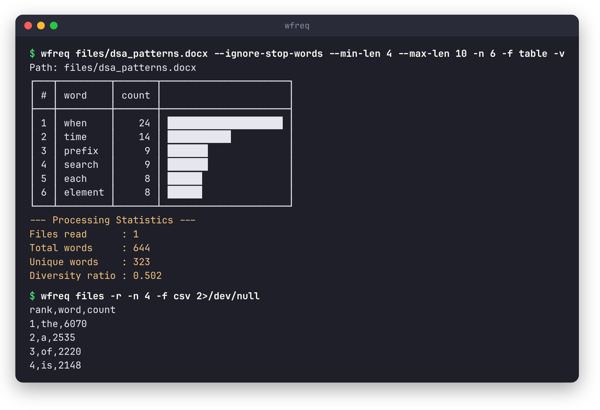
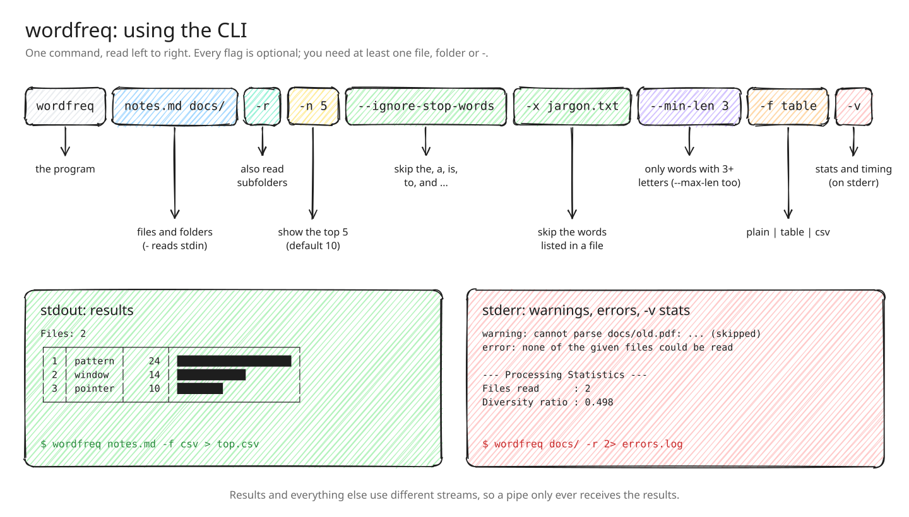
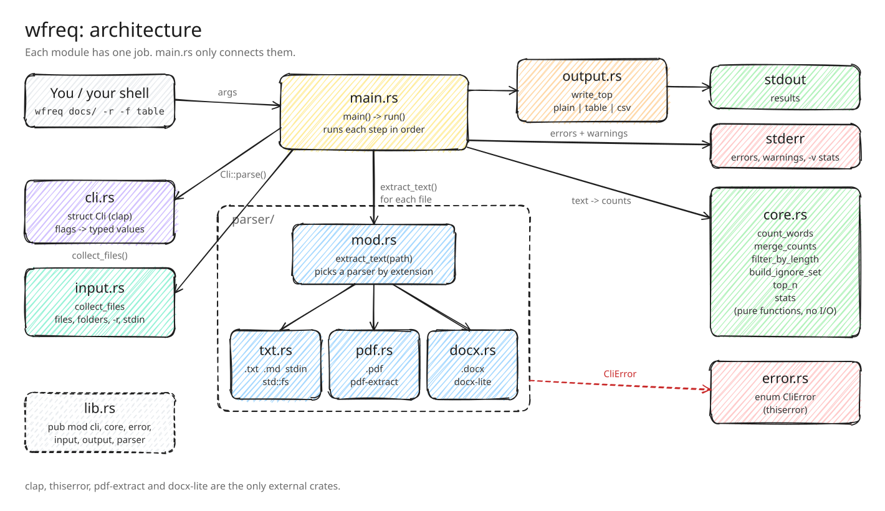
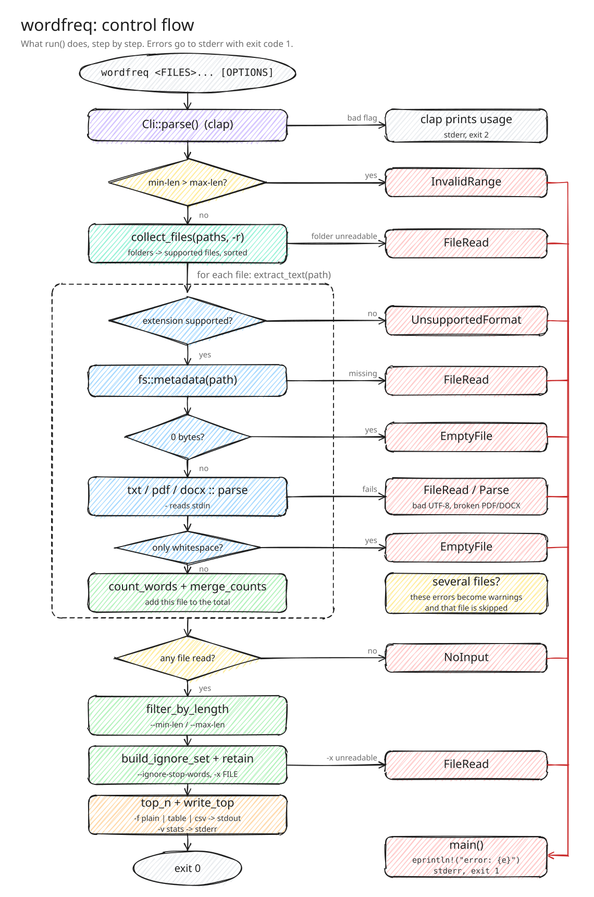

# wfreq

[](https://github.com/yashksaini-coder/wordfreq/actions/workflows/ci.yml)
[](https://crates.io/crates/wfreq)

A simple CLI tool that shows the top N most frequent words in one or more files.



## Demo


The demo runs the real binary on the sample files in [`files/`](files). To record it again:

```
./scripts/record-demo.sh
```

It needs [asciinema](https://asciinema.org) and [agg](https://github.com/asciinema/agg) (`cargo install --locked asciinema agg`).

## Supported files

- .txt
- .md
- .pdf
- .docx
- text piped in on stdin (use `-` as the file name)

File extensions are not case sensitive, so `NOTES.TXT` works too.

## Install

From crates.io:

```
cargo install wfreq
```

Or download a ready-made binary for Linux, macOS or Windows from the
[releases page](https://github.com/yashksaini-coder/wordfreq/releases).

Or build from source:

```
git clone https://github.com/yashksaini-coder/wordfreq
cd wordfreq
cargo build --release   # binary at target/release/wfreq
```

Needs Rust 1.88 or newer.

## Usage

```
wfreq [OPTIONS] <FILES>...
```

`<FILES>` can be any mix of files, folders and `-` for stdin. All of them are counted together.



One file:

```
$ wfreq files/cp.txt -n 3
Path: files/cp.txt
 1. n               8
 2. a               7
 3. standard        6
```

A folder, shown as a table:

```
$ wfreq files -n 3 -f table
warning: File files/empty_file.txt is completely empty (skipped)
warning: File files/empty_pdf.pdf is completely empty (skipped)
Files: 5
┌───┬──────┬───────┬──────────────────────┐
│ # │ word │ count │                      │
├───┼──────┼───────┼──────────────────────┤
│ 1 │ the  │  6070 │ ████████████████████ │
│ 2 │ a    │  2535 │ ████████             │
│ 3 │ of   │  2220 │ ███████              │
└───┴──────┴───────┴──────────────────────┘
```

Two files as CSV:

```
$ wfreq files/cp.txt files/dsa_patterns.docx -n 3 -f csv
rank,word,count
1,the,63
2,a,56
3,to,36
```

From stdin:

```
$ echo "to be or not to be" | wfreq - -n 2
Path: -
 1. be              2
 2. to              2
```

## Options

| Option                  | What it does                                                                   |
| ----------------------- | ------------------------------------------------------------------------------ |
| `-r, --recursive`       | When a folder is given, also read the files in its subfolders.                 |
| `-f, --format <FORMAT>` | `plain` (default), `table` or `csv`.                                           |
| `-n, --top <N>`         | How many words to show. Default is 10.                                         |
| `-i, --case-sensitive`  | Count `The` and `the` as different words. By default all words are lowercased. |
| `--ignore-stop-words`   | Skip common words: the, for, on, in, and, a, is, to.                           |
| `-x, --exclude <FILE>`  | Skip the words listed in a file, one word per line.                            |
| `--min-len <N>`         | Only count words with at least N letters. Default is 1.                        |
| `--max-len <N>`         | Only count words with at most N letters.                                       |
| `-v, --verbose`         | Print files read, total words, unique words, diversity ratio and time.         |
| `-h, --help`            | Show help.                                                                     |
| `-V, --version`         | Show version.                                                                  |

`--min-len` and `--max-len` count letters, not bytes, so `café` has 4 letters.

`--ignore-stop-words` and `--exclude` can be used together.

## Files and folders

- A file given by name is always tried. If its type is not supported, that is reported (see "Output and errors").
- A folder adds the supported files directly inside it. Other files, like `.csv`, are skipped.
- With `-r`, subfolders are read too.
- Files are read in alphabetical order, so the output is the same on every run.

## How words are counted

- Text is split on spaces and new lines.
- Everything except letters, numbers and apostrophes is removed, so `hello,` becomes `hello` and `don't` stays `don't`.
- Words are lowercased unless `--case-sensitive` is used.
- Counts from all files are added together.
- Words with the same count are sorted alphabetically.

## Output and errors

Only the results go to stdout. Warnings, errors and the `-v` stats go to stderr. So you can pipe or save the results without anything else mixed in:

```
wfreq docs/ -r -f csv > top.csv 2> errors.log
```

With `-f csv` there is no `Path:` or `Files:` line, only the CSV rows.

The tool stops with an error (exit code 1) when:

- `--min-len` is bigger than `--max-len`
- a folder cannot be read
- the `-x` file cannot be read
- none of the given files could be read

When you give one file, any problem with it is an error. When you give several files or a folder, a problem with one file is a warning and that file is skipped. These are the problems a file can have:

- it does not exist or cannot be read (the reason is shown, for example "Permission denied")
- it is not valid UTF-8 text
- it is a broken PDF or DOCX
- it is empty (0 bytes, or only spaces and new lines)
- its type is not supported

A wrong flag is reported by clap with exit code 2.

## Use it as a library

The counting code is a normal Rust library. A full runnable example is in
[examples/top_words.rs](examples/top_words.rs):

```
cargo run --example top_words -- files/cp.txt
```

```rust
use wfreq::core::{count_words, top_n};

let counts = count_words("the cat saw the dog", false);
let top = top_n(&counts, 2);
assert_eq!(top, vec![("the".to_string(), 2), ("cat".to_string(), 1)]);
```

API docs: `cargo doc --open`.

## Tests

```
cargo test
```

- **Unit tests** next to the code in `src/core.rs`, `src/output.rs` and `src/input.rs`.
- **Integration tests** in `tests/integration.rs` run the real binary and check stdout, stderr and the exit code.
- **Property tests** in `tests/properties.rs` use [proptest](https://crates.io/crates/proptest) to check rules for random input, for example "top_n is always sorted" and "the length filter keeps exactly the words in range".
- **Doc tests** run the examples in the API docs.

CI runs `cargo fmt --check`, `cargo clippy --all-targets -- -D warnings`, the tests, `cargo doc` with warnings denied, and a build on Rust 1.88. The crate has no `unsafe` code and `#![forbid(unsafe_code)]` keeps it that way, so there is nothing for Miri to check.

## Benchmarks

### Counting core (criterion)

```
cargo bench
```

| Benchmark | Time | Throughput |
| --- | --- | --- |
| `count_words`, 10k words | 672 µs | 114 MiB/s |
| `count_words`, 100k words | 5.82 ms | 132 MiB/s |
| `count_words`, 1M words | 52.2 ms | 148 MiB/s |
| `top_n` 10 of 1M words | 193 µs | |
| `filter_by_length` 3..=8 of 1M words | 89 µs | |

The input is generated text with a fixed seed (see `benches/count.rs`), so every run measures the same thing.

### Compared with the Unix pipeline

The classic way to do this in a shell is `tr | sort | uniq -c | sort -rn`. [benches/compare.sh](benches/compare.sh) runs both on the same 17 MB of English text (the Competitive Programmer's Handbook, 3.5 million words) with [hyperfine](https://github.com/sharkdp/hyperfine):

| Command | Mean time | Peak memory |
| --- | --- | --- |
| `wfreq corpus.txt -n 10` | **186.8 ms** ± 1.5 | **21 MiB** |
| `tr -cs "[:alnum:]'" '\n' \| tr A-Z a-z \| sort \| uniq -c \| sort -rn \| head` | 258.2 ms ± 8.2 | 412 MiB |

wfreq is about **1.4x faster** and uses about **20x less memory**, because it counts with a hash map instead of sorting every word. The pipeline uses `LC_ALL=C`, its fastest setting. Both find the same top words; counts differ slightly because the pipeline splits words at symbols like `-`, while wfreq removes the symbol and keeps one word.

**Hardware and software:** Intel Core i7-13620H (10 cores, 16 threads), 23 GiB RAM, Linux 7.2.8, rustc 1.98.1, release build, hyperfine 2.0.0, GNU coreutils 9.12. Numbers will differ on other machines.

## How it works

Each module has one job. `main.rs` only connects them: it reads the options, collects the files, asks the parser for each file's text, runs the counting and filters from `core.rs`, and prints the result through `output.rs`.



| File | Job |
| --- | --- |
| `src/main.rs` | Runs each step in order. |
| `src/cli.rs` | The command line options (clap). |
| `src/input.rs` | `collect_files`: turns files, folders and `-r` into a list of files. |
| `src/parser/mod.rs` | `extract_text`: checks a file and picks a parser by extension, or reads stdin. |
| `src/parser/txt.rs`, `pdf.rs`, `docx.rs` | Turn one file type into plain text. |
| `src/core.rs` | Counting, merging, filters, top N and stats. No file access. |
| `src/output.rs` | Writes the results as plain, table or csv. |
| `src/error.rs` | The `CliError` type used for every error. |

This is what happens on every run, and where each error comes from:



## Changelog

See [CHANGELOG.md](CHANGELOG.md).

## License

MIT, see [LICENSE](LICENSE).
